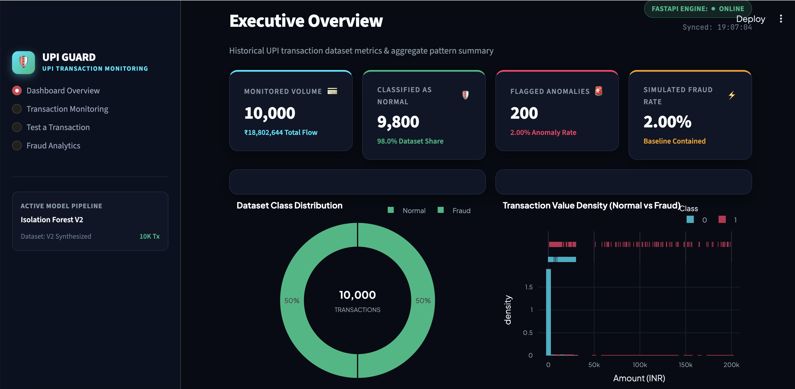
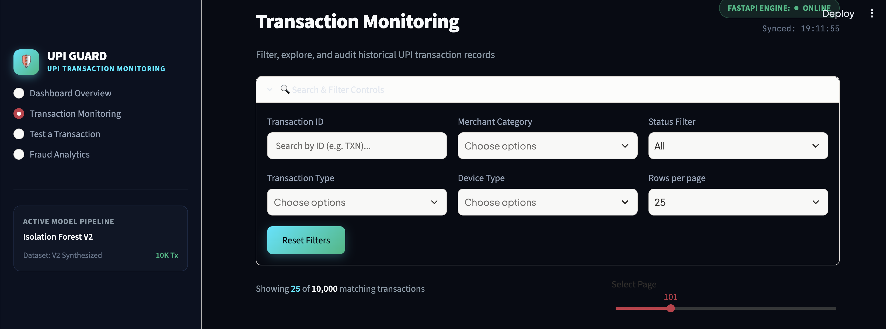
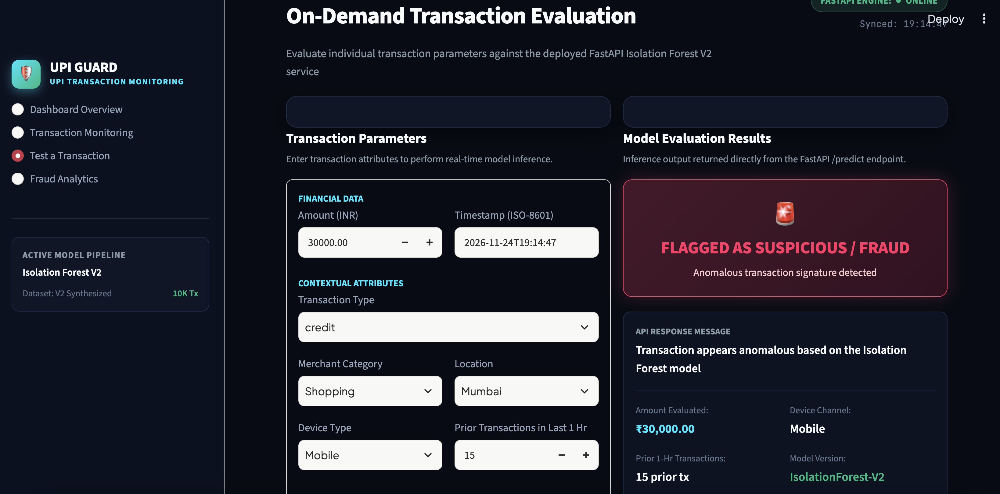
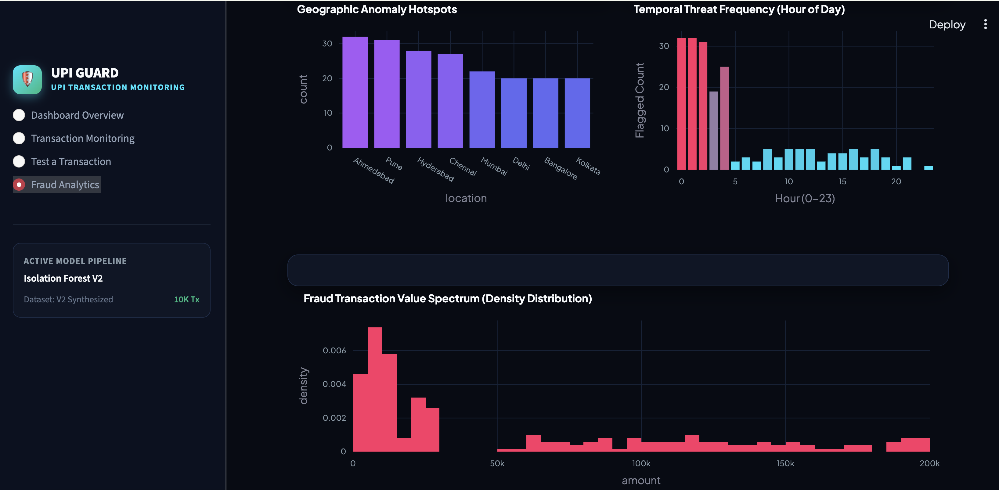

# UPI Fraud Detection & Transaction Monitoring System

An end-to-end UPI fraud detection prototype built using Python, Scikit-learn, FastAPI, Streamlit, and Plotly. The system analyzes 10,000 synthetic UPI transactions, identifies suspicious transaction patterns using an Isolation Forest machine learning model, provides on-demand transaction predictions through a REST API, and visualizes transaction insights through an interactive four-page dashboard.

## Project Overview

Digital payment platforms process large numbers of transactions every day, making the identification of suspicious activities an important challenge.

This project demonstrates how machine learning can be used to detect anomalous UPI transaction patterns. It combines an unsupervised machine learning model, a FastAPI prediction service, and an interactive Streamlit dashboard to support transaction analysis and monitoring.

The project uses a synthetic dataset and is developed for educational and demonstration purposes.

## Key Features

- **Fraud Detection:** Uses the Isolation Forest algorithm to identify anomalous transaction patterns.
- **Feature Engineering:** Extracts useful transaction features, including transaction hour, day, weekend indicator, night indicator, and logarithmic transaction amount.
- **Interactive Dashboard:** Provides a four-page Streamlit application for transaction monitoring and analysis.
- **Transaction Monitoring:** Supports transaction searching, filtering, and pagination.
- **On-Demand Prediction:** Provides transaction predictions through a FastAPI REST API.
- **Fraud Analytics:** Displays historical transaction insights using interactive Plotly charts.
- **Model Evaluation:** Evaluates performance using accuracy, precision, recall, F1-score, ROC-AUC, and a confusion matrix.
- **API Testing:** Includes automated tests for API endpoints and prediction functionality.

## Technology Stack

| Category             | Technologies         |
| -------------------- | -------------------- |
| Programming Language | Python               |
| Data Processing      | Pandas, NumPy        |
| Machine Learning     | Scikit-learn         |
| Algorithm            | Isolation Forest     |
| Backend              | FastAPI              |
| Frontend             | Streamlit            |
| Data Visualization   | Plotly               |
| Model Persistence    | Joblib               |
| Testing              | Pytest               |
| Development Tools    | VS Code, Git, GitHub |

## Dataset

The project uses a synthetic UPI transaction dataset containing 10,000 records.

| Dataset Attribute             |  Value |
| ----------------------------- | -----: |
| Total Transactions            | 10,000 |
| Normal Transactions           |  9,800 |
| Simulated Fraud Transactions  |    200 |
| Normal Transaction Percentage |    98% |
| Simulated Fraud Percentage    |     2% |

The dataset contains transaction-related information such as:

- Transaction amount
- Transaction timestamp
- Transaction type
- Merchant category
- Device type
- Location
- Number of transactions in the last hour
- Fraud label

**Note:** The dataset is synthetic and does not contain real customer or banking transaction records.

## Machine Learning Approach

### Algorithm: Isolation Forest

Isolation Forest is an unsupervised machine learning algorithm used for anomaly detection.

It identifies unusual observations by isolating data points through randomly generated decision trees. Anomalous observations are generally easier to isolate than normal observations.

The model is trained using transaction-related numerical features.

### Feature Engineering

The following features are generated:

| Feature               | Description                                                        |
| --------------------- | ------------------------------------------------------------------ |
| amount                | Transaction amount                                                 |
| transactions_last_1hr | Number of recent transactions                                      |
| transaction_hour      | Hour of the transaction                                            |
| transaction_day       | Day of the month                                                   |
| is_weekend            | Indicates whether the transaction occurred on a weekend            |
| is_night              | Indicates whether the transaction occurred between 00:00 and 04:59 |
| log_amount            | Logarithmic transformation of transaction amount                   |

The `is_fraud` column is used for dataset splitting and evaluation, not as a model input.

### Model Configuration

- Algorithm: Isolation Forest
- Number of Estimators: 100
- Contamination: 0.02
- Random State: 42
- Train-Test Split: 80:20
- Training Approach: Unsupervised learning

The dataset is split using stratification to preserve the normal and simulated fraud class proportions.

## Model Evaluation

The model was evaluated on a held-out synthetic test dataset containing 2,000 transactions.

### Performance Metrics

| Metric    | Result |
| --------- | -----: |
| Accuracy  | 98.20% |
| Precision | 54.55% |
| Recall    | 60.00% |
| F1-Score  | 57.14% |
| ROC-AUC   | 0.9866 |

### Confusion Matrix

| Actual / Predicted | Normal | Suspicious |
| ------------------ | -----: | ---------: |
| Normal             |   1940 |         20 |
| Simulated Fraud    |     16 |         24 |

### Performance Interpretation

- The model correctly identified 24 out of 40 simulated fraud transactions in the test dataset.
- It flagged 44 transactions as suspicious, of which 24 were simulated fraud cases.
- It missed 16 simulated fraud transactions.
- The high accuracy should be interpreted carefully because the dataset is imbalanced.

These results represent performance on a synthetic dataset and should not be interpreted as real-world banking fraud detection performance.

## System Architecture

The application follows a simple architecture with three main components:

1. **Data Processing and Machine Learning**

   - Loads the synthetic transaction dataset.
   - Performs feature engineering.
   - Trains and evaluates the Isolation Forest model.
   - Saves the trained model using Joblib.
2. **Backend API**

   - Built using FastAPI.
   - Loads the trained machine learning model.
   - Accepts transaction details through the prediction endpoint.
   - Returns a Normal or Suspicious prediction.
3. **Frontend Dashboard**

   - Built using Streamlit.
   - Displays historical transaction information.
   - Provides transaction filtering and monitoring.
   - Visualizes fraud analytics.
   - Allows users to test individual transactions through the API.

## Dashboard Pages

The Streamlit application contains four main pages.

### 1. Dashboard Overview

Provides a high-level summary of transaction activity through KPI cards, charts, and a recent transaction stream.

### 2. Transaction Monitoring

Allows users to search, filter, and inspect historical transactions using transaction details and pagination.

### 3. Test a Transaction

Allows users to enter transaction details and receive an on-demand prediction from the FastAPI backend.

### 4. Fraud Analytics

Provides interactive visualizations of historical transaction patterns, suspicious transaction distributions, and other analytical insights.

## API Documentation

## Dashboard Screenshots

### 1. Dashboard Overview



### 2. Transaction Monitoring



### 3. Test a Transaction



### 4. Fraud Analytics



The backend is developed using FastAPI.

### Available Endpoints

| Method | Endpoint     | Description                                            |
| ------ | ------------ | ------------------------------------------------------ |
| GET    | `/health`  | Checks backend health                                  |
| POST   | `/predict` | Predicts whether a transaction is normal or suspicious |

### Example Prediction Request

```json
{
  "amount": 25000,
  "transaction_time": "2026-11-24T02:30:00",
  "transaction_type": "debit",
  "merchant_category": "shopping",
  "device_type": "mobile",
  "location": "Mumbai",
  "transactions_last_1hr": 15
}
```

### Example Prediction Response

```json
{
  "prediction": "Suspicious"
}
```

The prediction is illustrative. Actual results depend on the supplied transaction data and trained model.

Interactive API documentation is available through FastAPI Swagger UI at:

`http://127.0.0.1:8000/docs`

## Project Structure

```text
UPI-Fraud-Detection/
│
├── backend/
│   └── main.py
│
├── data/
│   ├── raw/
│   │   └── upi_transactions_v2.csv
│   │
│   └── processed/
│       └── upi_transactions_features_v2.csv
│
├── frontend/
│   └── app.py
│
├── models/
│   └── isolation_forest_v2.pkl
│
├── src/
│   ├── feature_engineering.py
│   └── model_training_v2.py
│
├── tests/
│   └── test_api.py
│
├── screenshots/
│   ├── dashboard_overview.png
│   ├── transaction_monitoring.png
│   ├── test_transaction.png
│   └── fraud_analytics.png
│
├── requirements.txt
├── README.md
└── .gitignore
```

*The structure above highlights the main project files. Other supporting files may also exist in the repository.*

## Installation and Setup

### 1. Clone the Repository

```bash
git clone https://github.com/tanvimac/UPI-Fraud-Detection.git
cd UPI-Fraud-Detection
```

### 2. Create a Virtual Environment

```bash
python3 -m venv .venv
```

### 3. Activate the Virtual Environment

For macOS and Linux:

```bash
source .venv/bin/activate
```

### 4. Install Dependencies

```bash
pip install -r requirements.txt
```

### 5. Start the FastAPI Backend

Open the first terminal:

```bash
cd /Users/mac/Desktop/UPI-Fraud-Detection
source .venv/bin/activate
.venv/bin/uvicorn backend.main:app --reload
```

Backend address:

`http://127.0.0.1:8000`

### 6. Start the Streamlit Dashboard

Open a second terminal:

```bash
cd /Users/mac/Desktop/UPI-Fraud-Detection
source .venv/bin/activate
HOME="$PWD/.streamlit_home" .venv/bin/streamlit run frontend/app.py --server.address 127.0.0.1 --server.port 8501
```

Dashboard address:

`http://localhost:8501`

Keep both terminals running while using the application.

## Running Tests

Run the automated tests from the project root:

```bash
source .venv/bin/activate
.venv/bin/pytest -v
```

The project currently has 9 passing API tests.

## Limitations

- The project uses synthetic transaction data rather than real banking data.
- The model is a demonstration of unsupervised anomaly detection, not a production-grade fraud detection system.
- The API provides on-demand predictions and does not connect to live UPI payment systems.
- The dashboard displays historical data from the processed CSV dataset.
- New API predictions are not automatically added to the historical dashboard dataset.
- The model does not block, reverse, or authorize actual financial transactions.
- The model's performance on synthetic data does not guarantee performance on real-world transactions.

## Future Improvements

- Integrate a real-time transaction data pipeline using an appropriate authorized data source.
- Explore additional machine learning and deep learning algorithms.
- Improve fraud detection recall while controlling false positives.
- Add database integration for storing and retrieving transaction records.
- Add authentication and role-based access control.
- Develop alerts and notifications for suspicious transactions.
- Add monitoring for model drift and performance degradation.

## Disclaimer

This project is developed strictly for educational and demonstration purposes. It uses synthetic transaction data and is not connected to any real UPI, bank, or payment gateway system. Predictions should not be used for actual financial decisions.

## Author

**Tanvi Sharma**

B.Tech – Computer Science and Engineering

GitHub: https://github.com/tanvimac

LinkedIn: https://www.linkedin.com/in/tanvishrma/
